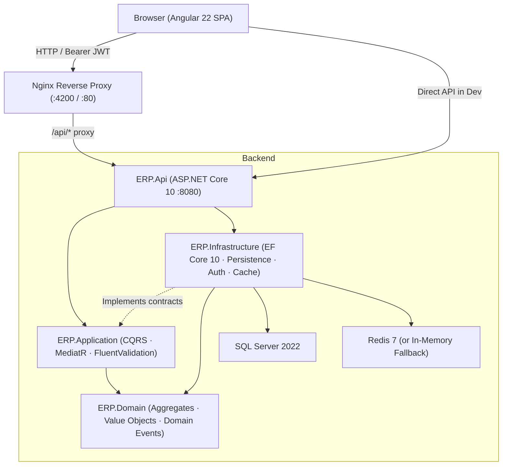
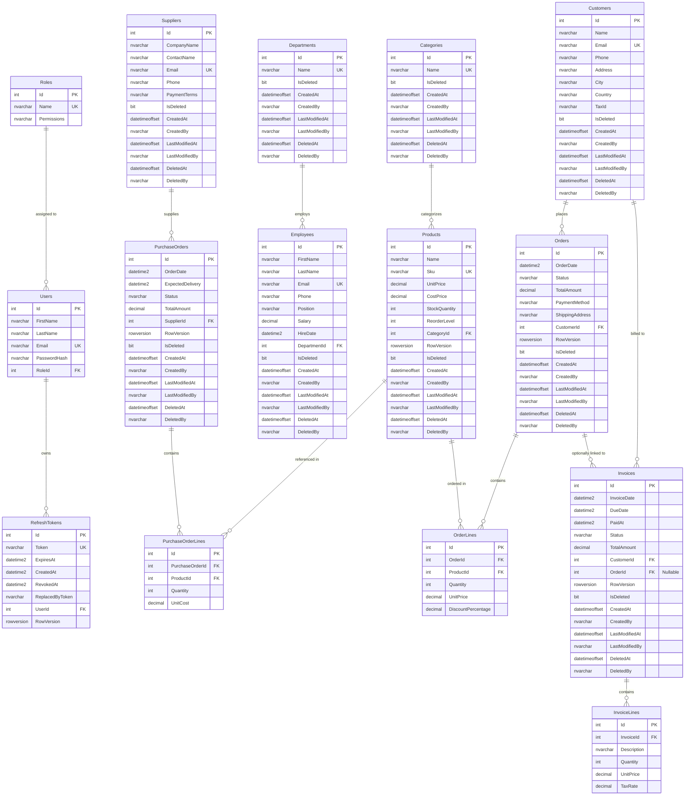

# ERP Management System

A full-stack Enterprise Resource Planning (ERP) web application featuring a .NET 10 REST API backend and an Angular 22 single-page application frontend.

---

## Overview

The system is a modular ERP platform covering six core business domains:
- **Sales:** Customer management and multi-line sales order lifecycle (`Pending` $\rightarrow$ `Processing` $\rightarrow$ `Shipped` $\rightarrow$ `Delivered` / `Cancelled`) with automatic inventory deduction and cancellation stock restoration via domain events.
- **Purchasing:** Supplier management and purchase order fulfillment (`Draft` $\rightarrow$ `Submitted` $\rightarrow$ `Approved` $\rightarrow$ `Received` / `Cancelled`) with automatic stock replenishment on receipt.
- **Catalog & Inventory:** Product catalog, SKU tracking, category management, reorder thresholds, and manual stock adjustment operations.
- **Finance:** Customer invoicing (`Draft` $\rightarrow$ `Sent` $\rightarrow$ `Paid` / `Overdue` / `Cancelled`), tax/line-item calculation, optional sales order linkage, and server-side PDF invoice generation.
- **Human Resources:** Employee directory, compensation records, and organizational department management.
- **Identity & Access Management:** User lifecycle management, JWT authentication with rotating refresh tokens, and fine-grained permission-based Role-Based Access Control (RBAC).

---

## Architecture

The backend follows **Clean Architecture** with **Domain-Driven Design (DDD)** tactical patterns (Aggregate Roots, Value Objects, Domain Events) and **CQRS** (via MediatR). The frontend is a standalone Angular 22 SPA using signal-based state and lazy-loaded feature routes.



### Dependency Flow

- **`ERP.Api`** $\rightarrow$ `ERP.Application` & `ERP.Infrastructure`
- **`ERP.Infrastructure`** $\rightarrow$ `ERP.Application` & `ERP.Domain` (implements data access, unit of work, caching, auth, PDF generation, and repository abstractions)
- **`ERP.Application`** $\rightarrow$ `ERP.Domain` (contains commands, queries, handlers, DTOs, domain event handlers, and validation rules)
- **`ERP.Domain`** has no external project dependencies.

---

## Technology Stack

- **Backend:** .NET 10 / ASP.NET Core Web API, Entity Framework Core 10 (SQL Server), MediatR, FluentValidation, JWT Bearer authentication, BCrypt.Net-Next, QuestPDF (invoice PDF exports), Serilog, Swashbuckle (Swagger UI).
- **Frontend:** Angular 22 (Standalone Components, Signals), Angular Material & CDK, TypeScript, RxJS, Vitest.
- **Infrastructure & Data:** SQL Server 2022, Redis 7 (via `StackExchange.Redis` with automatic `IMemoryCache` fallback), Nginx (Alpine container runtime with `/api/` reverse proxy), Docker & Docker Compose.
- **Testing:** xUnit (`ERP.Domain.Tests` unit tests and `ERP.Api.Tests` `WebApplicationFactory<Program>` integration tests), FluentAssertions, Vitest (`frontend`).

*(Detailed dependency versions are defined in `.csproj` and `package.json` files).*

---

## Project Structure

```
ERP-Management-System/
├── backend/
│   ├── ERP-Management-System.slnx  # .NET solution file
│   ├── ERP.Api/                    # ASP.NET Core Web API (Controllers, Program.cs, Auth, Middleware)
│   ├── ERP.Application/            # CQRS layer (Features, Pipeline Behaviors, Abstractions, Caching)
│   ├── ERP.Domain/                 # Core domain aggregates, entities, value objects, and domain events
│   ├── ERP.Infrastructure/         # EF Core persistence, Migrations, SeedData, Repositories, Redis/Memory Cache
│   ├── ERP.Domain.Tests/           # Domain & Application unit test suite (xUnit)
│   ├── ERP.Api.Tests/              # API authorization & integration test suite (WebApplicationFactory)
│   └── Dockerfile                  # Multi-stage .NET 10 container build
├── frontend/
│   ├── src/
│   │   ├── app/                    # Root application configuration and route definitions
│   │   ├── core/                   # AuthService, ApiService, authGuard, authInterceptor, models
│   │   ├── features/               # Lazily loaded feature modules (dashboard, sales, inventory, etc.)
│   │   ├── layout/                 # Shell layout, permission-aware sidebar, header, auth pages
│   │   ├── shared/                 # Reusable UI components (page-header, status-badge, confirm-dialog)
│   │   └── environments/           # Client environment configurations (apiUrl)
│   ├── nginx.conf                  # Nginx SPA static server + /api/ reverse proxy to erp-backend
│   └── Dockerfile                  # Multi-stage container build (Node 22 -> Nginx Alpine)
├── docker-compose.yml              # Local multi-container orchestration (SQL Server, Redis, Backend, Frontend)
└── .env.example                    # Environment variable template for Docker Compose
```

---

## Entity Relationship Diagram

The following diagram represents the ERP database schema and relationships as defined by the Entity Framework Core persistence model (`AppDbContext`). Soft-deletable entities with unique constraints (`Categories.Name`, `Products.Sku`, `Departments.Name`, `Employees.Email`, `Customers.Email`, `Suppliers.Email`) use filtered unique indexes (`WHERE [IsDeleted] = 0`). Aggregate roots and tokens that undergo concurrent state transitions use SQL Server `rowversion` (`RowVersion`) for optimistic concurrency control.



---

## Backend

### CQRS & Pipeline Behaviors
Requests dispatched through MediatR pass through three pipeline behaviors in `ERP.Application/Common/Behaviors/`:
1. **`LoggingBehavior`** — logs request execution lifecycle and exceptions.
2. **`PerformanceBehavior`** — logs warnings for requests exceeding 500 ms.
3. **`ValidationBehavior`** — executes registered FluentValidation validators prior to handler execution and returns `400 Bad Request` problem details on validation failures.

### Authentication & Rate Limiting
- **Endpoints (`/api/auth`):**
  - `POST /api/auth/login` — Authenticates user credentials and issues a short-lived JWT access token (including `"permission"` claims) and a persistent refresh token.
  - `POST /api/auth/refresh` — Validates and rotates an active refresh token, issuing a new JWT and refresh token pair.
  - `POST /api/auth/logout` — Revokes the provided refresh token (`[Authorize]`).
- **Session Revocation:** Changing a user's role or deleting a user automatically revokes all active refresh tokens for that user.
- **Rate Limiting:** `/api/auth` endpoints are protected by a fixed-window rate limiter (`"auth"` policy: 10 requests per minute per client IP, returning `429 Too Many Requests` when exceeded).

### Role-Based Access Control (RBAC) & Permissions
All business and administrative controllers enforce granular permission policies via `[HasPermission(Permissions.*)]`, backed by `PermissionPolicyProvider` and `PermissionAuthorizationHandler`:

| Controller / Route | Read Permission | Write / Action Permissions |
|---|---|---|
| `/api/customers` | `Customers.Read` | `Customers.Write` |
| `/api/orders` | `Orders.Read` | `Orders.Write` |
| `/api/products` | `Products.Read` | `Products.Write`, `Products.AdjustStock` (`POST /api/products/{id}/adjust-stock`) |
| `/api/categories` | `Categories.Read` | `Categories.Write` |
| `/api/suppliers` | `Suppliers.Read` | `Suppliers.Write` |
| `/api/purchaseorders` | `PurchaseOrders.Read` | `PurchaseOrders.Write` |
| `/api/invoices` | `Invoices.Read` (includes `GET /api/invoices/{id}/pdf`) | `Invoices.Write`, `Invoices.Send`, `Invoices.Pay` |
| `/api/employees` | `Employees.Read` | `Employees.Write` |
| `/api/departments` | `Departments.Read` | `Departments.Write` |
| `/api/admin/users` | `Users.Read` | `Users.Write` |
| `/api/admin/roles` | `Roles.Read` | `Roles.Write` |

#### Seeded Roles (`ERP.Infrastructure/Persistence/SeedData/roles.json`)
- **`Administrator`:** All 25 permissions across all modules.
- **`Sales`:** `Customers.Read`, `Customers.Write`, `Orders.Read`, `Orders.Write`, `Products.Read`, `Categories.Read`, `Invoices.Read`
- **`Warehouse`:** `Products.Read`, `Products.Write`, `Products.AdjustStock`, `Categories.Read`, `Categories.Write`
- **`Purchasing`:** `Suppliers.Read`, `Suppliers.Write`, `PurchaseOrders.Read`, `PurchaseOrders.Write`, `Products.Read`, `Categories.Read`
- **`Finance`:** `Customers.Read`, `Invoices.Read`, `Invoices.Write`, `Invoices.Send`, `Invoices.Pay`
- **`HR`:** `Employees.Read`, `Employees.Write`, `Departments.Read`, `Departments.Write`

### Database, Auditing & Concurrency
- **Engine:** SQL Server 2022 (`ERPDb`) with EF Core 10 and automatic transient failure retries (`EnableRetryOnFailure`).
- **Soft Deletes & Auditing:** `AppDbContext` applies global query filters (`IsDeleted == false`) for all `ISoftDeletable` entities and populates `CreatedAt`/`CreatedBy`, `LastModifiedAt`/`LastModifiedBy`, and `DeletedAt`/`DeletedBy` using `CurrentUserService`.
- **Filtered Unique Indexes:** Soft-deletable entities with unique keys (`Categories.Name`, `Products.Sku`, `Departments.Name`, `Employees.Email`, `Customers.Email`, `Suppliers.Email`) enforce uniqueness only across active records (`WHERE [IsDeleted] = 0`), allowing deleted names/SKUs/emails to be reused.
- **Optimistic Concurrency & Conflict Handling:** `Product`, `Order`, `Invoice`, `PurchaseOrder`, and `RefreshToken` include SQL Server `rowversion` tokens. `GlobalExceptionHandler` translates `DbUpdateConcurrencyException` and domain `ConflictException` into `409 Conflict` RFC 7807 `ProblemDetails` responses.
- **Domain Events & Unit of Work:** `UnitOfWork.SaveChangesAsync` iteratively dispatches domain events (e.g., `OrderCreatedDomainEvent`, `OrderCancelledDomainEvent`, `PurchaseOrderReceivedDomainEvent`) within the same database transaction before committing changes.
- **Automatic Migrations & Seeding:** On startup in `Development` (or when `Database:AutoMigrate=true`), `DbInitializer` runs pending EF Core migrations, seeds initial JSON data if tables are empty, and reconciles default role permissions.

### Caching (`RedisCacheService` & `InMemoryCacheService`)
- **Provider Selection:** When `ConnectionStrings:RedisConnection` is configured, `ERP.Infrastructure` registers `RedisCacheService` (`StackExchange.Redis`) using non-blocking async `SCAN` (`server.KeysAsync`) for prefix-based cache invalidation and resilient fallback if Redis is temporarily unreachable. When `ConnectionStrings:RedisConnection` is empty or omitted, the application automatically falls back to `InMemoryCacheService` (`IMemoryCache`).
- **Cache Key & Expiration Configuration:** Standardized under `ERP.Application/Common/Caching/CacheKeys.cs` and configured via the `CacheSettings` section in `appsettings.json` (`ReferenceDataExpirationMinutes`, `FrequentDataExpirationMinutes`, `PaginatedListExpirationMinutes`).

---

## Frontend

- **Architecture:** Standalone Angular 22 SPA with signal-based state management (`AuthService`) and lazy-loaded feature routes.
- **Major Feature Areas:** Dashboard, Sales & Orders, Inventory & Products (including Categories and Stock Adjustment), Purchasing & Suppliers, Invoices & Finance (with PDF export), HR (Employees & Departments), and System Administration (Users & Roles).
- **Auth & Token Lifecycle:**
  - `authInterceptor` attaches Bearer tokens to outgoing API requests and automatically intercepts `401 Unauthorized` responses to refresh expired access tokens via `POST /api/auth/refresh` and transparently retry failed requests.
  - `AuthService.logout()` revokes the active refresh token on the server via `POST /api/auth/logout` before clearing local session storage.
  - Permission-aware navigation and dashboard widgets inspect the user's granted permissions so non-admin roles only request and view authorized modules.

---

## Docker & Nginx Reverse Proxy

Defined in `docker-compose.yml` on the `erp-network` bridge network:

| Container | Image / Build | Port Mapping | Role |
|---|---|---|---|
| `erp-sqlserver` | `mcr.microsoft.com/mssql/server:2022-latest` | `1433:1433` | SQL Server 2022 database (volume: `mssql_data`) |
| `erp-redis` | `redis:7-alpine` | `6379:6379` | Redis 7 distributed cache (volume: `redis_data`) |
| `erp-backend` | `./backend/Dockerfile` (ASP.NET Core 10) | `8080:8080` | REST API (waits for SQL healthcheck & Redis) |
| `erp-frontend` | `./frontend/Dockerfile` (Angular 22 / Nginx) | `4200:80` | SPA frontend & reverse proxy (waits for backend) |

### Nginx Reverse Proxy (`frontend/nginx.conf`)
The frontend container runs Nginx on port `80` (mapped to host port `4200`):
- **Static SPA Hosting:** Serves the compiled Angular bundle from `/usr/share/nginx/html` with gzip compression, 6-month immutable caching for hashed static assets, and `try_files $uri $uri/ /index.html` fallback for client-side routing.
- **API Reverse Proxy:** Requests matching `/api/*` on the Nginx container are proxied directly to `http://erp-backend:8080/api/` with forwarded host and client IP headers (`X-Real-IP`, `X-Forwarded-For`, `X-Forwarded-Proto`).

---

## Configuration & Environment Variables

### 1. Docker Environment Variables (`.env` / `.env.example`)
Copy `.env.example` to `.env` before running Docker Compose:

| Variable | Description | Example / Default in `.env.example` |
|---|---|---|
| `MSSQL_SA_PASSWORD` | SQL Server `sa` account password (referenced by `erp-sqlserver` and `erp-backend`) | `YourStrong@Passw0rd` |
| `JWT_SECRET` | Symmetric signing key for JWT tokens ($\ge 32$ characters required) | `SUPER_SECRET_PRODUCTION_KEY_32_CHARS_MINIMUM_LONG` |
| `JWT_ISSUER` | JWT token issuer claim | `ERP.Api` |
| `JWT_AUDIENCE` | JWT token audience claim | `ERP.Client` |
| `JWT_EXPIRY_MINUTES` | Access token lifetime in minutes | `60` |

> **Security Note:** `.env` is excluded by `.gitignore`. Always replace `MSSQL_SA_PASSWORD` and `JWT_SECRET` with strong secrets before any non-local deployment.

### 2. Backend Application Settings (`backend/ERP.Api/appsettings*.json`)
- **`ConnectionStrings:DefaultConnection`:** SQL Server connection string.
- **`ConnectionStrings:RedisConnection`:** Redis endpoint (e.g., `localhost:6379` or `erp-redis:6379`). Leave empty to use the in-memory cache fallback.
- **`Jwt` (`Secret`, `Issuer`, `Audience`, `ExpiryMinutes`):** JWT signing and validation settings. The application validates at startup that `Jwt:Secret` is at least 32 characters long.
- **`CacheSettings` (`ReferenceDataExpirationMinutes`, `FrequentDataExpirationMinutes`, `PaginatedListExpirationMinutes`):** Cache TTL durations in minutes.
- **`Cors:AllowedOrigins`:** Optional string array of allowed CORS origins (defaults to `["http://localhost:4200"]` when not specified).
- **`Database:AutoMigrate`:** Optional boolean to run migrations and seed data outside the `Development` environment.

### 3. Frontend Environments (`frontend/src/environments/`)
- **`environment.ts` / `environment.development.ts`:** Configures `apiUrl` (defaults to `http://localhost:8080/api`).

---

## Getting Started

### Prerequisites
- **Docker Setup (Recommended):** Docker Desktop with Compose V2.
- **Local Setup (Alternative):** .NET 10 SDK, Node.js 22 + npm, SQL Server (or LocalDB), and optionally Redis.

---

### Running with Docker (Recommended)

1. Copy the environment configuration template:
   ```sh
   copy .env.example .env
   # On Linux/macOS: cp .env.example .env
   ```
2. Build and start containers:
   ```sh
   docker compose up --build
   ```
3. Access the application:
   - **Frontend SPA:** http://localhost:4200
   - **Backend API:** http://localhost:8080
   - **Swagger UI:** http://localhost:8080/swagger *(Development environment)*

*(Database migrations and initial seed data are applied automatically on startup).*

---

### Running Locally (Without Docker)

1. **Start Backend:**
   Verify connection strings in `backend/ERP.Api/appsettings.Development.json` (uses `(localdb)\mssqllocaldb` by default; if Redis is not running locally, either start Redis on `localhost:6379` or set `ConnectionStrings:RedisConnection` to `""` to use the in-memory cache), then run:
   ```sh
   cd backend
   dotnet run --project ERP.Api
   ```
   *(Migrations and seed data execute automatically on startup).*

2. **Start Frontend:**
   ```sh
   cd frontend
   npm install
   npm start
   ```
   Access the SPA at http://localhost:4200.

---

## Demo Credentials

The following Administrator account is seeded automatically on initial database setup:

| Role | Email | Password |
|---|---|---|
| Administrator | `admin@erpco.com` | `Admin123456` |

---

## Testing & Development Commands

### Backend (.NET 10 / xUnit)
- **Build Entire Solution:**
  ```sh
  dotnet build backend/ERP-Management-System.slnx
  ```
- **Run All Backend Tests (Unit + API Integration):**
  ```sh
  dotnet test backend/ERP-Management-System.slnx
  ```
- **Run Domain & Application Unit Tests Only (`ERP.Domain.Tests`):**
  ```sh
  dotnet test backend/ERP.Domain.Tests/ERP.Domain.Tests.csproj
  ```
- **Run API Authorization & Integration Tests Only (`ERP.Api.Tests`):**
  ```sh
  dotnet test backend/ERP.Api.Tests/ERP.Api.Tests.csproj
  ```
- **Create an EF Core Migration:**
  ```sh
  cd backend
  dotnet ef migrations add <MigrationName> --project ERP.Infrastructure --startup-project ERP.Api
  ```
- **Apply EF Core Migrations Manually:**
  ```sh
  cd backend
  dotnet ef database update --project ERP.Infrastructure --startup-project ERP.Api
  ```

### Frontend (Angular 22 / Vitest)
- **Production Build:**
  ```sh
  npm --prefix frontend run build
  ```
- **Run Unit Tests (Single Run):**
  ```sh
  npm --prefix frontend test -- --watch=false
  ```

---

## CI/CD & Deployment Notes

- **Containerized Deployment:** Production-ready multi-stage `Dockerfile` definitions are provided for both the .NET 10 API (`backend/Dockerfile`, running as non-root `$APP_UID`) and the Angular 22 SPA (`frontend/Dockerfile`, served via `nginx:alpine` with `frontend/nginx.conf`).
- **CORS Hardening:** In production environments, set `Cors:AllowedOrigins` (e.g., via environment variables `Cors__AllowedOrigins__0=https://erp.example.com`) to restrict cross-origin requests to trusted domains.
- **Swagger Availability:** Swagger UI (`/swagger`) is enabled only when `ASPNETCORE_ENVIRONMENT=Development`.
- **CI/CD Pipelines:** No automated CI/CD workflow files (e.g., `.github/workflows/`) or cloud orchestration manifests (Kubernetes/Helm/Terraform) are currently included in the repository; standard `dotnet test`, `npm run build`, `npm test -- --watch=false`, and `docker compose build` commands can be wired directly into any CI runner.
